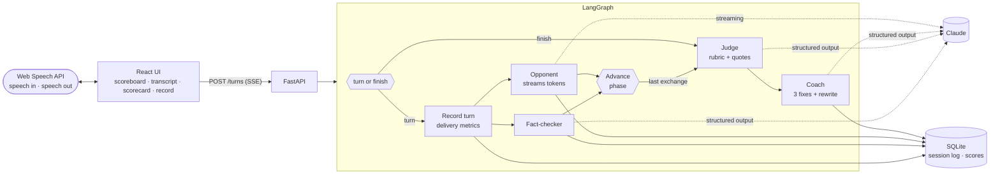

# DebateDojo

**Spar with an AI that argues back, then get scored and coached.**

DebateDojo is a practice ring for arguing. Prepare for a formal debate, rehearse a proposal against a sceptical stakeholder, or drill sales objections against a buyer who has heard it all. You speak or type against a turn clock. The opponent answers what you actually said, and a fact-checker flags shaky claims on the transcript as you go. At the bell, a judge scores you against a rubric, quoting your own words as evidence, and a coach rewrites your weakest turn. Every session is logged, so the record shows whether practice is working.

<!-- The film: drag promo/out/debate-dojo-promo-web.mp4 onto this line in the GitHub editor, replacing this note. -->

## What it shows

| | |
|---|---|
| **Four agents in one graph** | A LangGraph `StateGraph`. After each turn the fact-checker and the streamed opponent run in parallel; at the end the judge and the coach run in sequence |
| **Three modes** | Debate (the AI takes the other side), Meeting (a finance director, engineering lead or head of operations pushes back) and Sales (a buyer raises price, timing, the tool they already use and the boss) |
| **Formats as data** | Oxford-style, Lincoln-Douglas-style and rapid fire debates, plus turn-based meeting and sales formats, all in YAML with timed phases you can change |
| **Rubric scoring with evidence** | Five criteria per mode, each with a score, an explanation and a quote that is verified against what you actually said |
| **Voice in the browser** | Web Speech API for your turns, speech synthesis for the opponent, and delivery metrics: pace, filler words, longest pause, talk time against the limit |
| **Honest fact-checking** | Flags unsupported or doubtful claims with the evidence that would back them. It says when it is judging on knowledge alone, and can only cite pages a web search actually returned |
| **Memory and progress** | The full log in SQLite: every turn, phase, timing, flag and delivery metric. A record view charts each criterion across sessions |
| **Runs offline** | A deterministic scripted model reads the same prompts as Claude, so the whole product runs, tests and evals with no API key |

## Architecture



The format decides the phases; the session's position is derived from how many turns are in the log, so it never drifts. More detail, including the event protocol, the timer rules and how quotes are verified, is in [docs/architecture.md](docs/architecture.md).

## Run it

**Locally, no API key needed.** This uses the scripted model:

```bash
cd backend
uv sync
DEBATEDOJO_LLM=scripted DEBATEDOJO_SCRIPTED_DELAY=0.05 uv run debatedojo serve --port 8060   # API on :8060
cd ../frontend && pnpm install && pnpm dev                                                    # UI on :5185
```

The dev server proxies `/api` to `DEBATEDOJO_API`, which defaults to `http://127.0.0.1:8060`. Voice input needs a browser with the Web Speech API, such as Chrome or Safari; typing works everywhere.

**With Claude:**

```bash
export ANTHROPIC_API_KEY=sk-ant-...
cd backend && uv run debatedojo serve --port 8060
```

With a key set, Claude is the default. The opponent streams, the fact-checker and the judge use structured outputs, and the judge and the coach use adaptive thinking at high effort. Set `DEBATEDOJO_FACT_CHECK_WEB=true` to let the fact-checker run a web search first.

**With Docker:**

```bash
cp .env.example .env    # add your key, or leave it empty for the scripted model
docker compose up --build
open http://localhost:8080
```

**From the terminal:**

```bash
uv run debatedojo formats          # the formats and their phases
uv run debatedojo eval --verbose   # the judge-calibration evals
```

## Tests and evals

```bash
cd backend && uv run pytest        # formats, phases, timers, delivery metrics, rubric, store, graph, API
cd frontend && pnpm test           # delivery metrics, SSE parser, event reducer, router
```

The filler-word and pace rules exist in Python for the judge and in TypeScript for the live meter, and both suites run against the same fixture, so they cannot drift apart.

`debatedojo eval` plays whole sessions through the real graph. The cases check that the fact-checker flags an unsourced statistic and leaves a sourced one alone, that a sales reply which ignores the objection scores low on acknowledge, that a meeting with no ask scores low on clear ask, that every opponent reply engages the turn it answers, that every criterion has an explanation and a verified quote, and that nothing the agents write contains an em dash. In CI it runs offline on the scripted model:

```
  flagged         2/2
  engages         12/12
  report          12/12
  calibration     10/10
  coach           12/12
  style           12/12
  not_flagged     1/1
  reply_includes  1/1

12/12 cases passed
```

## Project layout

```
backend/
  debatedojo/
    graph.py          the agents: nodes, edges, streamed events
    formats.py        formats, personas, plan and position
    prompts.py        prompts for the opponent, fact-checker, judge and coach
    rubric.py         rubrics per mode and the structured-output schemas
    metrics.py        delivery metrics: pace, fillers, pauses, talk time
    llm.py            Claude client (streaming, structured outputs, web search)
    scripted.py       the deterministic scripted model
    store.py          SQLite session log and progress
    service.py        sessions, turns and verdicts, shared by the API and evals
    api.py            FastAPI + SSE
    evals.py          the eval runner
  formats/            one YAML file per format
  personas.yaml       stakeholders, buyers and sample topics
  evals/cases.yaml    judge-calibration cases
frontend/
  src/components/     Scoreboard, PhaseStrip, TurnCard, Arena, Report, Record
  src/useVoice.ts     speech in and out, with the timings delivery needs
  src/delivery.ts     the live delivery meter
  src/session.ts      one reducer folds streamed events into the arena
fixtures/             delivery-metric cases shared by both test suites
```

## The film

The promo is made in code from the running app, not screen-recorded; it will be added here.

---

Part of [the Lab](https://balajisriraj.com/#lab), agentic products by [Balaji Sri Raj](https://balajisriraj.com).
