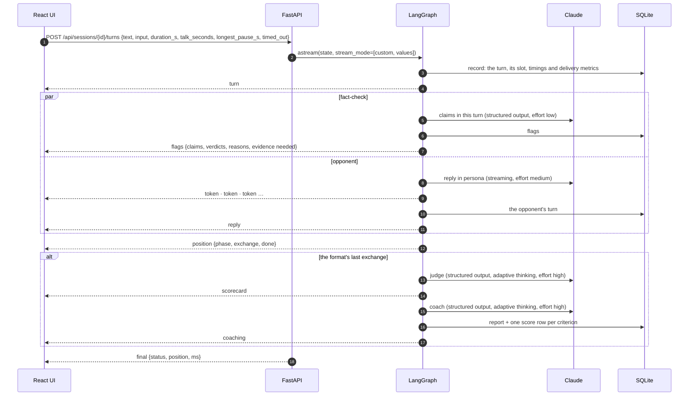

# Architecture

## A turn, end to end

The fact-checker and the opponent are two branches of the same LangGraph superstep, so the flags land on the transcript while the reply is still streaming. `advance` waits for both.

## Nodes

| Node | Does | Model call |
|---|---|---|
| `record` | Works out which slot the turn fills from the number of user turns so far, measures delivery and saves the turn | None |
| `fact_check` | Lists factual claims and rules on each: supported, unsupported or doubtful, with a reason and the kind of evidence that would back it. Claims are pinned back to the user's exact words. A failure here never costs the turn | Structured output, low effort. Optional web search pass first |
| `opponent` | Plays the persona for the mode and the phase's role, with the whole session so far as alternating messages | Streaming, medium effort |
| `advance` | Recomputes the position. When the plan is done, marks the session `judging` and routes to the judge | None |
| `judge` | Scores every rubric criterion with an explanation and a quote of the user's own words | Structured output, adaptive thinking, high effort |
| `coach` | Three highest-leverage improvements, then a rewrite of the weakest turn and why it is stronger | Structured output, adaptive thinking, high effort |

`POST /api/sessions/{id}/finish` enters the same graph at `judge`, for ending a session early or retrying a verdict that failed.

## Formats are data

`backend/formats/*.yaml` define every format as an ordered list of phases. Each phase has a number of exchanges, a turn limit in seconds, guidance for the user and a role for the opponent:

| Format | Mode | Phases |
|---|---|---|
| Oxford-style | debate | Opening 3:00 · Rebuttal 2:00 · Closing 1:30 |
| Lincoln-Douglas-style | debate | Constructive 4:00 · Cross-examination 3 × 1:00 · Rebuttal 2:30 |
| Rapid fire | debate | 5 × 0:30 |
| Meeting run-through | meeting | Pitch 2:00 · Pushback 3 × 1:30 · The ask 1:00 |
| Objection drill | sales | Opening 1:30 · Objections 4 × 1:00 · Close 1:00 |

`formats.plan()` flattens a format into slots; `formats.position()` maps "n user turns taken" onto a slot. Because the position is derived from the log rather than stored, a reload, a retry or a rolled-back turn can never leave it out of step. The user's timer changes are applied once when the session starts (clamped to 15 s to 10 min) and stored with the session, so the log records the format as it was actually run.

Opponent roles are `opening`, `constructive`, `rebuttal`, `closing`, `answer` (cross-examination: answer the question, then ask one back), `rapid`, `probe`, `pushback`, `object` and `decide`. Meeting stakeholders work through their own list of concerns, one per pushback; buyers raise their four objections (price, timing, the tool they already use, the boss) once each, then ask what the next step would be.

## Timers

The clock is client-side, because it has to feel instant. It arms at the slot's limit and starts on the user's first word, typed or spoken, so reading the opponent's reply costs nothing. At zero it submits whatever is in the box with `timed_out: true`; the server accepts an empty turn only in that case, records it as over time and the opponent carries on. The server also marks a turn over time if its reported duration exceeds the limit by more than a two-second grace.

## Voice and delivery metrics

Speech-to-text uses the Web Speech API, feature-detected with the prefixed constructor (`SpeechRecognition ?? webkitSpeechRecognition`). It runs continuously with interim results while the mic is open; each result's arrival time is recorded. The opponent's replies are read with `speechSynthesis`, with a mute that is remembered. Typing always works, and a turn can mix both.

| Metric | How |
|---|---|
| Words per minute | Words over the seconds the mic was open. Only for spoken turns, and only from 3 s of speech |
| Filler words | "um", "uh", "like", "you know", "basically", "sort of", with neighbouring-word rules so "I like this" and "do you know" don't count. Recognition output usually has no commas, so the rules don't rely on them |
| Longest pause | The widest gap between speech results while the mic was open, including from opening the mic to the first word |
| Talk time | Seconds spoken against the slot's limit, and whether the turn ran over |

The filler rules exist twice, in `metrics.py` for the judge and `delivery.ts` for the live meter, and both are tested against one fixture, `fixtures/delivery-cases.json`.

## The judge's evidence

Every criterion's quote is checked against the user's turns, ignoring case, spacing and punctuation, and replaced with the exact original wording. A quote the model paraphrased is snapped to the closest real sentence and marked `quote_exact: false`. A scorecard that misses a criterion is sent back once with the problem stated; the coach is held to exactly three improvements the same way. All agent output has em and en dashes replaced with plain hyphens before it is stored.

## Rubrics

| Mode | Criteria |
|---|---|
| Debate | argument, evidence, rebuttal, structure, delivery |
| Meeting | clarity, data, handling pushback, common ground, clear ask |
| Sales | acknowledge, clarify, reframe, evidence, next step |

The rubric per mode is fixed in code (`rubric.py`) so scores are comparable across sessions. The progress view plots each criterion over finished sessions in a mode.

## Fact-checking and sources

By default the checker rules on the model's own knowledge and the UI says so. With `DEBATEDOJO_FACT_CHECK_WEB=true` and Claude, it first runs one pass with Claude's server-side web search tool (`web_search_20260209`, at most three searches, resuming a paused turn up to twice), then makes the structured ruling with those notes. A flag can only cite URLs that the search actually returned; anything else the model names is dropped.

## Memory

SQLite, one file:

| Table | Holds |
|---|---|
| `sessions` | Mode, format as run (timers applied), topic, side, persona, context, status, overall score |
| `turns` | Every turn from both sides in order, with slot, phase, exchange, input (voice, typed or model), duration, limit, timed out, delivery metrics |
| `fact_checks`, `flags` | How many claims each user turn had, and each flag with verdict, reason, evidence needed, method and sources |
| `reports` | The scorecard and the coaching |
| `scores` | One row per criterion per finished session, for the progress view |

A turn whose opponent reply fails is deleted, so the user can resend it; the UI puts their words back in the box.

## The scripted model

`scripted.py` implements the same `LLM` protocol as Claude and reads the same tagged prompts. It is deterministic, so tests and evals are exact, and it is written to be a credible sparring partner for demos:

- The opponent quotes the user's most substantive clause and answers the kind of claim it is: a figure with no source, an appeal to unnamed research, an absolute, a causal leap. In rebuttals it tracks which of its own arguments the user took on and presses the ones they dodged.
- Meeting stakeholders check whether the last concern was actually answered before raising the next; buyers notice when an objection was skipped.
- The judge scores observable features (reasoning links, signposts, sourced figures, acknowledgements, clarifying questions, reframes, dated next steps, delivery metrics) and quotes the sentence that best evidences each score.
- The coach turns the three lowest criteria into advice and rewrites the weakest turn with placeholders like `[your figure]` rather than invented numbers.

## Evals

`debatedojo eval` plays scripted users through whole sessions and checks:

| Check | Meaning |
|---|---|
| `flagged` / `not_flagged` | The fact-checker flags a bare statistic or an absolute, and leaves a sourced figure alone |
| `engages` | Every opponent reply picks up the words of the turn it answers |
| `reply_includes` | Role-specific behaviour, e.g. answering a cross-examination question |
| `report` | Every criterion has an explanation and a quote that is the user's own words |
| `calibration` | Score bounds, e.g. a sales reply that ignores the objection scores at most 3 on acknowledge |
| `coach` | Three improvements and a rewrite of a turn that exists |
| `style` | No em or en dashes in anything an agent wrote |
